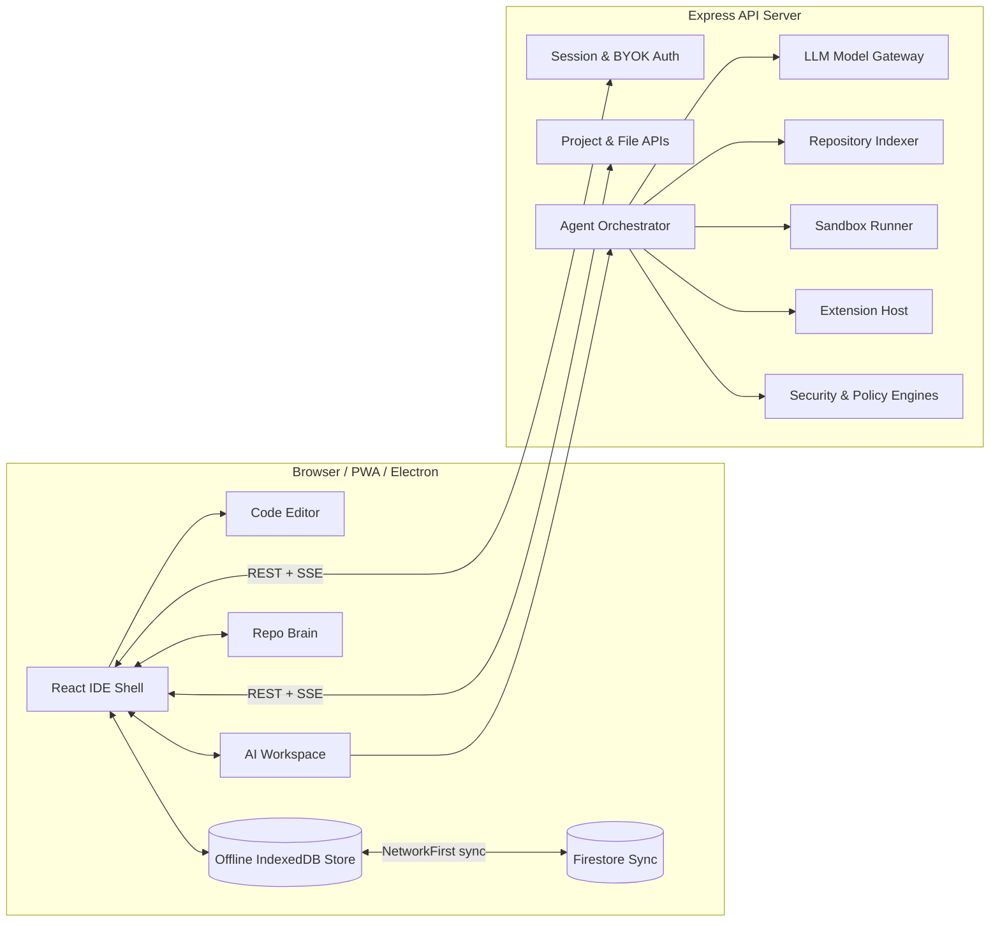
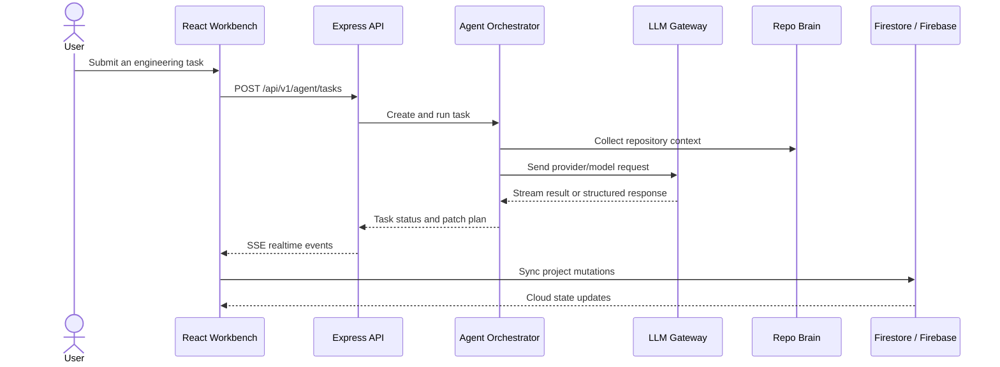
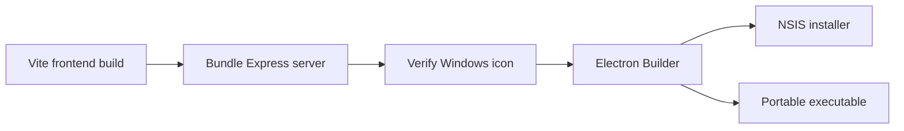

# 

<p align="center">
  <a href="https://git.io/typing-svg">
    
  </a>
</p>

<p align="center">
  
  
  
  
  
  
</p>

<p align="center">
  
  
  
</p>

<p align="center">
  
</p>

## 🚀 Overview

**DevMind Studio** is a cross-platform AI software engineering environment built with React, TypeScript, Vite, Express, Firebase, and Electron.

It combines repository understanding, autonomous agent workflows, an isolated code sandbox, extension management, security analysis, debugging, execution history, cloud synchronization, and offline local state in one workbench.

```text
IDE workspace
    ├── AI agent planning and execution
    ├── Repository indexing and semantic search
    ├── Code editing and project file operations
    ├── Sandbox execution and terminal output
    ├── Security and policy controls
    ├── Debugging and execution history
    ├── Extension marketplace and command host
    └── Firebase cloud sync + offline cache
```

---

## ✨ What You Can Do

| Capability | Included Experience |
| :--- | :--- |
| **🤖 AI Workspace** | Chat with an autonomous coding agent, review proposed steps, approve changes, and stream results. |
| **🧠 Repo Brain** | Index repository files, extract symbols, build architecture context, and search code with hybrid ranking. |
| **📦 Sandbox Runner** | Execute code and view live terminal-style output inside an isolated runner. |
| **🧩 Extensions** | Discover, install, uninstall, activate, and execute extension commands through the extension host. |
| **🛡️ Security Center** | Scan repositories for secret patterns and security findings, with secret redaction support. |
| **📋 Policy Controls** | Configure governance rules for agent and workspace actions. |
| **🐞 Debugging** | Inspect debugging sessions and application/runtime context. |
| **📜 Execution History** | Review previous agent runs and task outcomes. |
| **☁️ Firebase Sync** | Synchronize project state with Firestore where it is configured. |
| **📡 Offline Mode** | Continue editing and queue mutations locally through IndexedDB and the offline mutation pipeline. |
| **⌨️ Command Palette** | Navigate screens and execute commands with keyboard-first controls. |
| **💻 Desktop Delivery** | Package the application as NSIS and portable Windows builds. |

---

## 🏗️ System Architecture



### Data and Event Flow



---

## 🧭 Main Workspace Views

| View | Purpose |
| :--- | :--- |
| **Dashboard** | Project overview, repository health, and quick actions |
| **Code Editor** | Edit project files and navigate repository content |
| **AI Workspace** | Plan, execute, and review AI-assisted engineering tasks |
| **Repo Brain** | Search context, symbols, architecture, and repository relationships |
| **Debugging Center** | Work with debugging sessions and runtime information |
| **Execution History** | Inspect prior runs and task results |
| **Security Center** | Review security findings and redacted secrets |
| **Extensions** | Browse and manage extension integrations |
| **Settings & Policy** | Manage LLM configuration and action policies |

---

## 🔌 API Surface

The application exposes versioned REST endpoints under `/api/v1` and a Server-Sent Events stream.

| Area | Example Endpoints |
| :--- | :--- |
| Health & Providers | `GET /api/v1/health`, `GET /api/v1/providers` |
| Realtime Sync | `GET /api/v1/events` |
| Authentication | `POST /api/v1/auth/login`, `GET /api/v1/auth/session`, `POST /api/v1/auth/logout` |
| LLM Configuration | `POST /api/v1/auth/test-llm`, `PUT /api/v1/auth/llm-config` |
| Projects | `GET|POST /api/v1/projects`, `DELETE /api/v1/projects/:id` |
| Repository Index | `POST /api/v1/projects/:id/index`, `GET /api/v1/projects/:id/architecture` |
| Files & Search | `PUT|DELETE /api/v1/projects/:id/files`, `POST /api/v1/projects/:id/search` |
| Chat & Debug | `GET|POST /api/v1/projects/:id/chat`, `GET|POST /api/v1/projects/:id/debug` |
| Agent Tasks | `GET|POST /api/v1/agent/tasks`, `PATCH /api/v1/agent/tasks/:id/priority` |
| Approvals | `POST /api/v1/approvals/:id/decision`, rollback and cancellation routes |
| Policies & Audit | `GET|PUT /api/v1/policies`, `GET /api/v1/audit` |
| Extensions | install, uninstall, toggle, activate, and execute commands |

> Protected project, extension, agent, approval, policy, billing, and audit routes require an active server session.

---

## ⚡ Quick Start

### Prerequisites

- Node.js 20 or newer
- npm or Bun
- Firebase project configuration, if cloud features are enabled
- An API key for a supported LLM provider, if AI completions are required

### 1. Install dependencies

```bash
npm install
```

You may also use Bun:

```bash
bun install
```

### 2. Create local environment variables

```bash
cp .env.example .env
```

| Variable | Purpose | Default |
| :--- | :--- | :--- |
| `PORT` | Express server port | `3000` |
| `APP_URL` | Public application URL used by provider integrations | `http://localhost:3000` |

Additional runtime variables used by the server include `HOST`, `NODE_ENV`, `DEVMIND_DIST_DIR`, and `DEVMIND_EMBEDDED`.

### 3. Start the development server

```bash
npm run dev
```

Open `http://localhost:3000`.

The development command starts the full Express application and serves the Vite frontend.

### 4. Verify the API

```bash
curl http://localhost:3000/api/v1/health
```

Expected response:

```json
{
  "ok": true,
  "service": "devmind-studio-core",
  "timestamp": "..."
}
```

---

## 🔑 LLM Configuration

DevMind supports bring-your-own-key configuration through the server gateway and authenticated session settings.

Provider presets are returned from:

```text
GET /api/v1/providers
```

Before running agent tasks, configure:

1. Provider
2. Base URL
3. Model
4. API key

API keys are user-provided session configuration and should not be committed to source control.

---

## ☁️ Firebase & Offline Sync

The Firebase client is initialized from `firebase-applet-config.json`. Firestore uses persistent IndexedDB caching with multiple-tab support and falls back to memory or default caching when persistent cache initialization is unavailable.

Offline behavior includes:

- IndexedDB project and file caching
- Pending mutation queues
- Automatic replay when connectivity returns
- Online/offline status indicators
- Network-first API caching in the PWA service worker

Before enabling cloud synchronization, verify:

- Firebase Authentication provider configuration
- Firestore database configuration
- Firestore rules in `firestore.rules`
- Allowed application origin
- Local and production environment configuration

---

## 📱 Install as a PWA

DevMind is configured as an installable Progressive Web App with:

- Standalone display mode
- 192px and 512px icons
- Maskable icon support
- Offline asset caching
- Network-first API caching
- Automatic service worker updates

In supported browsers:

1. Open DevMind over HTTPS or localhost.
2. Open the browser install menu.
3. Choose **Install DevMind Studio**.

---

## 🪟 Windows Desktop Build

### Build NSIS and portable applications

```bash
npm run build:win
```

Or use the Windows batch wrapper:

```bat
build-windows-exe.bat
```

The Electron build produces:

- `DevMind Studio-1.0.0-win-x64-Setup.exe`
- `DevMind Studio-1.0.0-win-x64-Portable.exe`
- Supporting output in `dist-electron/`

### Build stages



The desktop packaging configuration is in `electron-builder.yml`, while Electron entry points are located in `electron/main.cjs` and `electron/preload.cjs`.

---

## 🛠️ npm Scripts

| Command | Description |
| :--- | :--- |
| `npm run dev` | Start the Express + Vite development application |
| `npm start` | Start the server entry point |
| `npm run build` | Build the React frontend |
| `npm run build:server` | Bundle the Express server |
| `npm run build:win` | Build web assets, server, and Windows Electron packages |
| `npm run preview` | Preview the Vite production bundle |
| `npm run lint` | Run TypeScript validation |
| `npm run clean` | Remove generated build folders |

---

## 📂 Project Structure

```text
devmind-ai/
├── .github/workflows/       # Windows build automation
├── desktop/                 # Desktop wrapper scripts
├── electron/
│   ├── assets/              # Application icons
│   ├── main.cjs             # Electron main process
│   └── preload.cjs          # Electron preload bridge
├── public/
│   ├── assets/              # Static web assets
│   └── pwa-*.png            # PWA and app icons
├── scripts/
│   ├── build-server.mjs     # Server bundling
│   ├── build-win-exe.ps1    # Windows build automation
│   └── ensure-win-icon.mjs  # Windows icon preparation
├── server/
│   ├── agentOrchestrator.ts # Agent execution and session store
│   ├── extensionHost.ts     # Extension marketplace and command host
│   ├── modelGateway.ts      # LLM providers and usage estimation
│   ├── policyEngine.ts      # Workspace and action policies
│   ├── repoBrain.ts         # Repository indexing and search
│   ├── sandboxRunner.ts     # Isolated code execution
│   └── securityEngine.ts    # Security scans and secret redaction
├── src/
│   ├── components/          # Workspace screens and panels
│   ├── hooks/               # PWA and connectivity hooks
│   ├── services/            # API, offline state, and Firebase sync
│   ├── types/               # Shared application types
│   ├── App.tsx              # Application shell
│   ├── firebase.ts          # Firebase initialization
│   └── index.css            # Themes and global styles
├── server.ts                # Express server and API routes
├── vite.config.ts           # Vite and PWA configuration
├── firestore.rules          # Firestore access rules
└── electron-builder.yml      # Windows desktop package configuration
```

---

## 🔐 Security Practices

- Never commit API keys or production Firebase credentials.
- Keep `.env` files outside version control.
- Use the secret redaction helpers before returning repository text.
- Apply and test Firestore security rules for every cloud collection.
- Review agent patches and approval decisions before execution.
- Restrict provider base URLs and validate session configuration.
- Treat repository content and extension output as untrusted input.

---

## 🧪 Validation

Run the available project checks:

```bash
npm run lint
npm run build
npm run build:server
```

Before packaging:

```bash
npm run build:win
```

---

## 🗺️ Workflow Example

```text
1. Import or open a project
2. Build the repository index
3. Search or inspect code with Repo Brain
4. Ask the AI workspace to plan a change
5. Review the proposed patch and execution steps
6. Approve the task or configure policy constraints
7. Run the agent and inspect sandbox output
8. Debug or continue in the execution workspace
9. Sync accepted changes to Firebase
10. Package, export, or continue offline
```

---

## 🤝 Contributing

1. Fork the repository.
2. Create a focused feature branch.
3. Keep UI, API, offline behavior, and desktop changes synchronized.
4. Run lint and build checks.
5. Add setup details for new environment variables or integrations.
6. Submit a pull request with verification steps.

---

## 📄 License

Licensed under the [MIT License](LICENSE).

<p align="center">
  
</p>
